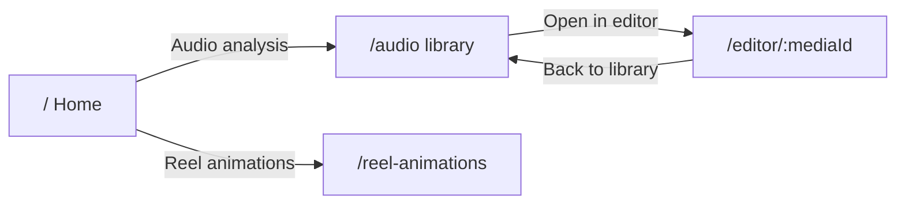

# UI Design

Krayon uses a home screen with two product tiles, then an **audio library** for browsing videos and an **editor** for processing a single video. **Reel animations** is a 9:16 teaching-canvas workspace with a Timeline | Chat split.

## Pages

| Route | Page | Purpose |
|-------|------|---------|
| `/` | Home | Two tiles: Audio analysis, Reel animations |
| `/audio` | Dashboard | Folder + video library, preview, metadata |
| `/reel-animations` | Reel animations | 9:16 canvas, compact timeline, and reel-assistant chat |
| `/editor/:mediaId` | Editor | Single-video processing workspace |



## Home layout

Two equal tiles centered in the shell: **Audio analysis** (silence removal & clip grouping) and **Reel animations** (9:16 teaching canvas).

## Reel animations layout

Portrait reels only (9:16). No landscape editor.

```
┌──────────────────────────────────────────────────────────────────┐
│  Home   project name                              theme  Export  │
├──────────┬───────────────────────────────────────────────────────┤
│  9:16    │  Timeline | Chat  │  Canvas Takes Captions Audio …    │
│  canvas  ├───────────────────────────────────────────────────────┤
│          │  Timeline (full width)  OR  Reel assistant chat       │
│  playbar │                                                       │
└──────────┴───────────────────────────────────────────────────────┘
```

- **Top bar (~44px)** — Home, editable project name, app light/dark toggle, Export (solid primary).
- **Far left** — 9:16 canvas, always exactly 9:16. Size is `min(stage width, stage height × 9/16, 45% of the workspace)` with a 220px preferred minimum; on a short window it scales down. Explicit pixel width/height; the left column is the fitted reel plus padding. Compact playbar underneath.
- **Right column** — remaining width. The tool row’s primary control is a large `Timeline | Chat` tab switch (Cmd/Ctrl+K toggles). Secondary ghost tools follow: Canvas, Takes, Captions, Audio, Zoom, then Settings right-aligned. Takes, Captions, and Zoom are disabled (“Coming soon”). Below ~900px, tool labels collapse to icons.
- **Timeline view** — existing tracks, full width, compact rows. Double-click (or Enter on a focused block) opens an **Edit element** modal with the same Config fields as before. Save is one undo step; Cancel / Escape discards; a dirty dialog ignores outside clicks. There is no Config/JSON inspector on the page.
- **Chat view** — reel assistant wired to `POST /api/reel/jobs` (script) and refine. Apply writes through `setElements` (undoable). The reel preview stays visible on the left with the same sizing.
- The chosen Timeline | Chat view is persisted in `localStorage` (`krayon-workspace-side-view`). Default is Timeline.
- **Gemini key** lives in the first-party cookie `krayon_gemini_api_key` (`SameSite=Strict`, not `HttpOnly`) and is sent only as `X-Gemini-Api-Key` on create/refine. Never localStorage.

### App chrome tokens (Velo-like)

Defined on `:root` and `.dark` in [`src/frontend/index.css`](../src/frontend/index.css). Canvas skins (`components/canvas/designs/*`) are a separate `RenderTheme`.

| Token | Light | Dark |
| --- | --- | --- |
| background | `#F6F7F9` | `#0A0A0C` |
| panels / card | `#FFFFFF` | `#101014` |
| raised | `#FFFFFF` | `#16161B` |
| border | `#E4E6EB` | `#23232A` |
| muted text | `#6B6B76` | `#8B8B96` |
| primary | `#2563EB` | `#3B82F6` |

Sans: Geist Variable. Timeline type blocks use tinted fill + 1px border + coloured text (`--timeline-box-*`, `--timeline-number-*`, `--timeline-arrow-*`). Row height 32px, ruler 24px, track labels ~96px.

## Dashboard layout

```
┌─────────────────────────────────────────────────────────────┐
│  Krayon                                         library      │
├──────────┬──────────────────────────────┬───────────────────┤
│ Library  │         Video preview        │   Video details   │
│ (videos) │         (center)             │  + Open in editor │
└──────────┴──────────────────────────────┴───────────────────┘
```

- **Left** — `LibrarySidebar`: folder path, Open folder, video list
- **Center** — `VideoPlayer`: streams original with 20s UI cap for all file sizes
- **Right** — `DashboardPanel`: metadata + **Open in editor** button

No silence removal or clip controls on the dashboard.

## Editor layout

While **Analyze silence** is running, the center panel shows `PipelineStepper` (vertical step list with per-step % and elapsed time). When complete, it switches to `ClipAudioPlayer`. See [pipeline-stages.md](./pipeline-stages.md) for what each step does under the hood.

```
┌─────────────────────────────────────────────────────────────┐
│  ← Back to library   Krayon                    video.mov    │
├──────────┬──────────────────────────────┬───────────────────┤
│ Clips    │  Video player OR pipeline    │     Controls      │
│ (after   │  stepper while running       │ Analyze silence,  │
│ analysis)│                              │ list toggle, tools│
└──────────┴──────────────────────────────┴───────────────────┘
```

- **Left** — `ClipsSidebar`: appears after analysis completes
  - **Speech clips only** (default): grouped similar takes, play icon per row
  - **All segments**: chronological speech + silence rows (silence in mild red)
  - Truncated labels show full text on hover (tooltip)
- **Center** — `ClipAudioPlayer` or `PipelineStepper` during async job
- **Right** — `ControlsPanel`: **Analyze silence** (transcribe + segment + group + extract clip audio), editable thresholds with help tooltips, **analysis run** version selector, stats footer, segment list toggle, tools

### Clip list interactions

| Action | Behavior |
|--------|----------|
| Click row | Preview in center — seeks source video to segment range (paused) |
| Click play icon | Preview and start playback within segment range |
| Silence row | Seeks source video to gap range |

## Stack

- **React Router** — `/`, `/audio`, `/reel-animations`, `/editor/:mediaId`
- **Zustand** — shared `media-store` and `silence-store` across routes
- **SSE** — `/api/clips/generate/async` + `/api/clips/progress/{jobId}` for pipeline progress
- **Tailwind CSS v4** — tokens in [`src/frontend/index.css`](../src/frontend/index.css)

## Key components

| Path | Role |
|------|------|
| `src/frontend/pages/HomePage.tsx` | Two-tile product home |
| `src/frontend/pages/DashboardPage.tsx` | Audio library dashboard |
| `src/frontend/pages/ReelAnimationsPage.tsx` | 9:16 reel editor (timeline + chat) |
| `src/frontend/pages/EditorPage.tsx` | Single-video editor |
| `src/frontend/components/layout/LibrarySidebar.tsx` | Video list |
| `src/frontend/components/layout/ClipsSidebar.tsx` | Grouped clips + all-segments timeline |
| `src/frontend/components/layout/DashboardPanel.tsx` | Metadata + Open in editor |
| `src/frontend/components/layout/ControlsPanel.tsx` | Analyze silence + threshold inputs (with help) + version selector + stats footer + list mode toggle |
| `src/frontend/components/player/PipelineStepper.tsx` | Pipeline progress UI — see [pipeline-stages.md](./pipeline-stages.md) |
| `src/frontend/components/player/ClipAudioPlayer.tsx` | Editor clip audio preview |
| `src/frontend/components/player/VideoPlayer.tsx` | Dashboard library video preview |
| `src/frontend/components/layout/AppShell.tsx` | Shared header |

## Folder persistence

Last folder path stored in `localStorage` under key `krayon:lastFolder` and restored on app load.

## Editor state persistence

Each **Analyze silence** run is saved under the video folder as versioned state. Re-opening `/editor/:mediaId` restores the last active run (clips sidebar, stats, options) without re-processing.

### On-disk layout

Co-located with the per-folder cache at `{video_folder}/.krayon/`:

```
.krayon/
  state/
    {mediaId}/
      index.json                 # version list + activeVersionId
      versions/
        {versionId}/             # e.g. 2026-08-23T19-05-00_a1b2c3
          manifest.json          # full persisted payload (words + transcript)
          transcript.txt         # plain full-run transcript
```

- **mediaId** — `sha256(resolved_path)[:16]`, same as the editor URL param
- **index.json** — append-only version history; `activeVersionId` points at the newest run after each analysis
- **manifest.json** — options, analysis (incl. word timings), clips (incl. per-clip words), groups, and `transcript`

### Version behavior

| Action | Behavior |
|--------|----------|
| Open editor | `GET /api/editor/state/{mediaId}` loads active manifest into stores |
| Re-analyze | Creates a new `versions/{versionId}/` folder; prior runs stay on disk |
| Switch run | Version dropdown in Controls → `PUT /api/editor/state/{mediaId}/active` |
| Clip playback | Editor: extracted clip audio WAV; Dashboard: 20s original stream |

The version selector appears only when saved history exists. **Analyze silence** never clears prior segment data from the UI until the new run completes.
